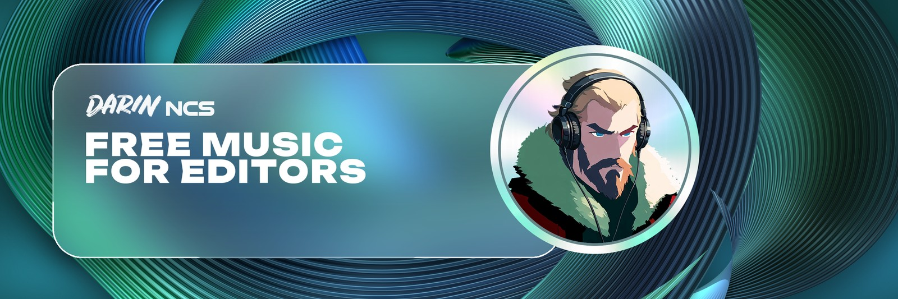
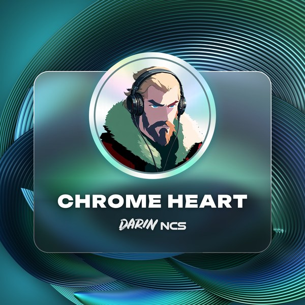

<p align="center">
  
</p>

<p align="center">
  <a href="https://www.youtube.com/channel/UCigaJiPLjDdbjokZFFs4-QA?sub_confirmation=1"></a>
  <a href="https://github.com/Akwice/darin-ncs-free-music/tree/main/tracks"></a>
  <a href="https://discord.gg/fcUTQS8tfF"></a>
  
</p>

<h3 align="center">Copyright-free dark-pop and cinematic tracks, built for AMV and anime edits. Free custom tracks on request.</h3>

Every track is mastered, cut for editing (early drops, clean silences, a slow bridge for slow-mo) and free to use in your edits. Grab the studio-quality **WAV** here, put it in your timeline, and go.

## Tracks

| | Track | Made for | Edit points | Listen | Download |
|:-:|---|---|---|:-:|:-:|
|  | **Chrome Heart**<br><sub>Dark-pop cyberpunk · 140 BPM · 3:28</sub> | Cyberpunk: Edgerunners | `0:54` countdown<br>`0:56` **drop**<br>`1:52` drop<br>`2:20` slow bridge<br>`2:36` final drop | [YouTube](https://youtu.be/l_jcNy9884A) | [WAV](https://github.com/Akwice/darin-ncs-free-music/raw/main/tracks/Darin_NCS_-_Chrome_Heart.wav) |

<sub>New tracks every week. All WAV files are 24-bit / 44.1 kHz stereo, mastered at about −12 LUFS.</sub>

## Tracks on request

Need a track for your next edit? Send me three things and I'll make it, **for free**:

| | |
|---|---|
| **Theme** | revenge, awakening, heartbreak, villain arc, last stand... |
| **Anime or character** | the show, arc or character you're editing |
| **Music style** | dark-pop, phonk, rock, cinematic, slowed, EDM drop... |

Email **darin.gmv@gmail.com** with "Request" in the subject. Requested tracks come out on the channel and in this repo, copyright-free like the others.

## How to use them

1. Tap the track's **WAV** link: the download starts right away (all files are also in [`tracks/`](tracks)).
2. Use it in your edit: YouTube, YouTube Shorts, TikTok, Instagram Reels, Twitch, and more.
3. Add the credit in your description:

```
Music: Darin NCS - Track Name
https://youtu.be/<link of the track>
```

### You can
- Use the tracks in edits, AMVs, Shorts, streams and videos, monetized or not.
- Cut, loop, slow down or speed up the audio to fit your edit.

### Please don't
- Re-upload a track on its own as a music-only video or to streaming platforms.
- Claim the music as your own or register it with Content ID.
- Sell the tracks or include them in sound packs.

Content ID is turned off on every Darin NCS track, so your edits won't get claims. If something ever goes wrong, write to me and I'll sort it out.

## Made an edit with a track?

Send me the link: I share the best edits on the channel. Email **darin.gmv@gmail.com** or comment under the track on YouTube.

Want to know when a new track drops? Join the **[Discord](https://discord.gg/fcUTQS8tfF)**: every new track is posted there first. Prefer email? Write "subscribe" to the same address. Already on the list and want out? Reply **STOP** to any email and you won't hear from me again.

---

<p align="center"><sub>Darin NCS · music made with AI tools (Suno), mixed and mastered for editing · <a href="https://www.youtube.com/channel/UCigaJiPLjDdbjokZFFs4-QA">YouTube</a></sub></p>
