<p align="center">
  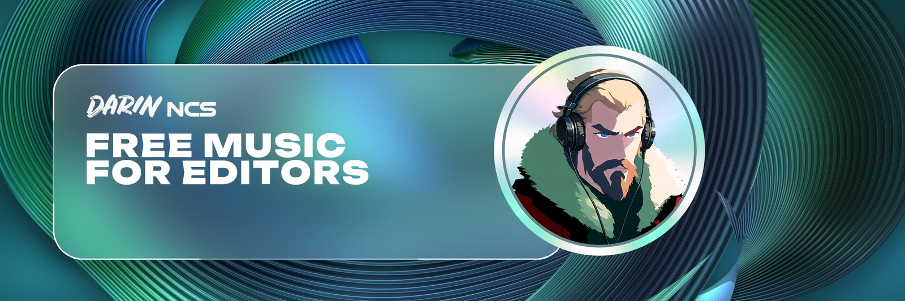
</p>

<p align="center">
  <a href="https://www.youtube.com/channel/UCigaJiPLjDdbjokZFFs4-QA?sub_confirmation=1"></a>
  <a href="#tracks"></a>
  <a href="https://discord.gg/fcUTQS8tfF"></a>
  
</p>

<h3 align="center">Copyright-free dark-pop and cinematic tracks, built for AMV and anime edits. Free custom tracks on request.</h3>

Every track is mastered, cut for editing (early drops, clean silences, a slow bridge for slow-mo) and free to use in your edits. Grab the studio-quality **WAV** here, put it in your timeline, and go.

## Tracks

| | Track | Made for | Edit points | Listen | Download |
|:-:|---|---|---|:-:|:-:|
| 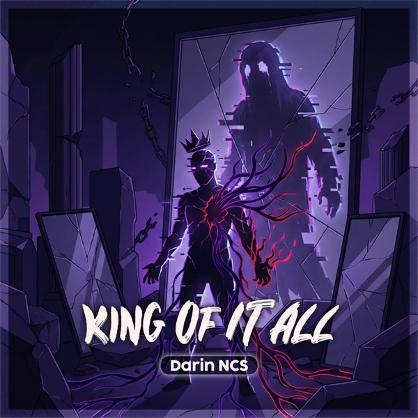 | **King Of It All**<br><sub>Dark-pop cinematic, female vocals · 120 BPM · 3:22</sub> | Villain arcs, any anime | `0:42` cut<br>`0:45` **drop**<br>`1:41` chorus<br>`2:12` bridge<br>`2:33` final drop | [YouTube](https://youtu.be/YEkOGKl_cIo) | [WAV](https://github.com/Akwice/darin-ncs-free-music/raw/main/tracks/Darin_NCS_-_King_Of_It_All.wav) |
| 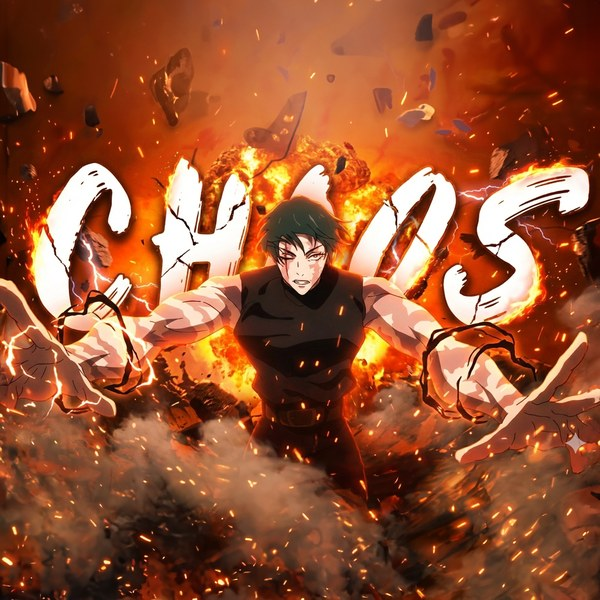 | **Chaos is King**<br><sub>Dark-pop cinematic, female vocals · 136 BPM · 3:42</sub> | Jujutsu Kaisen (Culling Game) | `0:23` cut<br>`0:28` **drop**<br>`0:52` drop<br>`2:14` drop<br>`3:09` final drop | [YouTube](https://youtu.be/OLd70cLjh_4) | [WAV](https://github.com/Akwice/darin-ncs-free-music/releases/download/chaos-is-king/Darin_NCS_-_Chaos_is_King.wav) |
| 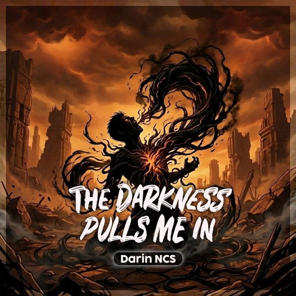 | **The Darkness Pulls Me In**<br><sub>Melancholic rock · 137 BPM · 4:14</sub> | Inner-demon arcs, any anime | `0:30` **drop**<br>`0:55` drop<br>`1:44` drop<br>`2:15` drop | [YouTube](https://youtu.be/5dmneeaL_8A) | [WAV](https://github.com/Akwice/darin-ncs-free-music/releases/download/the-darkness-pulls-me-in/Darin_NCS_-_The_Darkness_Pulls_Me_In.wav) |
| 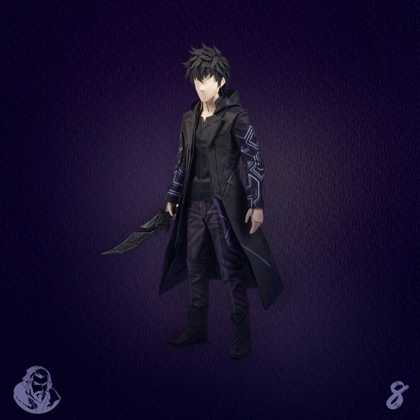 | **Arise**<br><sub>Dark-pop cinematic, male vocals · 129 BPM · 4:41</sub> | Solo Leveling | `0:23` cut<br>`0:26` **drop**<br>`1:47` drop<br>`2:22` drop<br>`3:20` final drop | [YouTube](https://youtu.be/7Sc9-ywN9aY) | [WAV](https://github.com/Akwice/darin-ncs-free-music/releases/download/arise/Darin_NCS_-_Arise.wav) |
|  | **Dust To Dust**<br><sub>Dark-pop, male vocals + UK grime rap · 136 BPM · 3:24</sub> | Dragon Ball Super (Beerus), villain arcs | `0:40` silence + "Kneel"<br>`0:43` **drop**<br>`1:51` drop<br>`2:21` slow bridge<br>`2:48` final chorus | [YouTube](https://youtu.be/TEWPDbkKFBQ) | [WAV](https://github.com/Akwice/darin-ncs-free-music/releases/download/dust-to-dust/Darin_NCS_-_Dust_To_Dust.wav) |
| 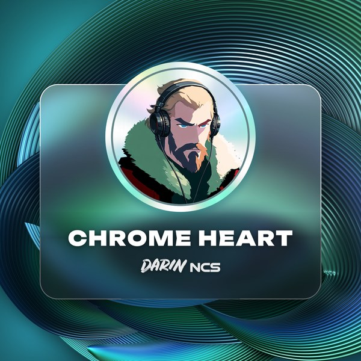 | **Chrome Heart**<br><sub>Dark-pop cyberpunk · 140 BPM · 3:28</sub> | Cyberpunk: Edgerunners | `0:54` countdown<br>`0:56` **drop**<br>`1:52` drop<br>`2:20` slow bridge<br>`2:36` final drop | [YouTube](https://youtu.be/l_jcNy9884A) | [WAV](https://github.com/Akwice/darin-ncs-free-music/raw/main/tracks/Darin_NCS_-_Chrome_Heart.wav) |
| 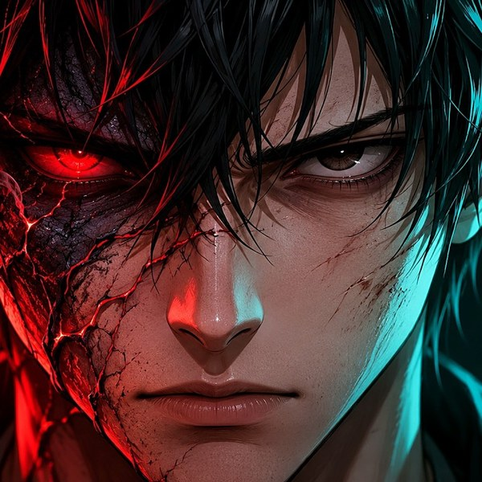 | **Born With Nothing (Phonk)**<br><sub>Drift phonk · 1:27</sub> | Black Clover, any anime | `0:18` **drop**<br>`0:40` drop<br>`1:02` drop | [YouTube](https://youtu.be/X1ZLT5FcnYo) | [WAV](https://github.com/Akwice/darin-ncs-free-music/releases/download/born-with-nothing-phonk/Darin_NCS_-_Born_With_Nothing_Phonk.wav) |
| 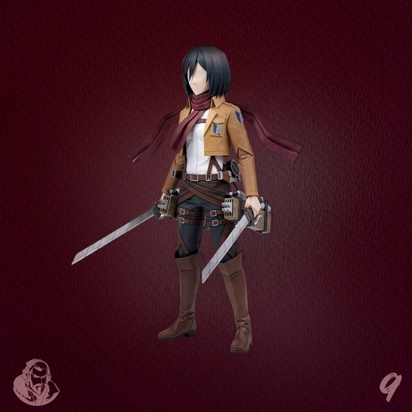 | **Follow You Down**<br><sub>129 BPM · 3:38</sub> | Attack on Titan | `0:58` cut<br>`1:02` **drop**<br>`1:36` drop<br>`2:26` cut<br>`2:28` drop | [YouTube](https://youtu.be/nzvME5kfQgA) | [WAV](https://github.com/Akwice/darin-ncs-free-music/releases/download/follow-you-down/Darin_NCS_-_Follow_You_Down.wav) |
| 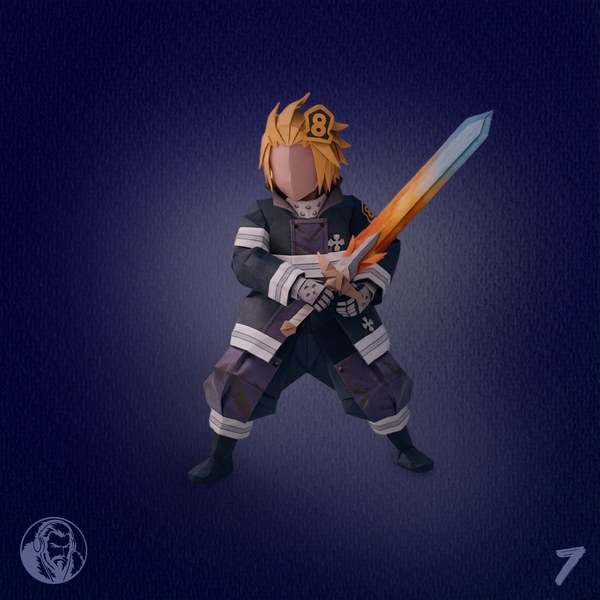 | **Watch The World Ignite**<br><sub>129 BPM · 4:05</sub> | Fire Force | `0:09` **drop**<br>`1:01` drop<br>`1:31` cut<br>`1:34` drop<br>`2:15` drop | [YouTube](https://youtu.be/2UPAaZW09TQ) | [WAV](https://github.com/Akwice/darin-ncs-free-music/releases/download/watch-the-world-ignite/Darin_NCS_-_Watch_The_World_Ignite.wav) |
| 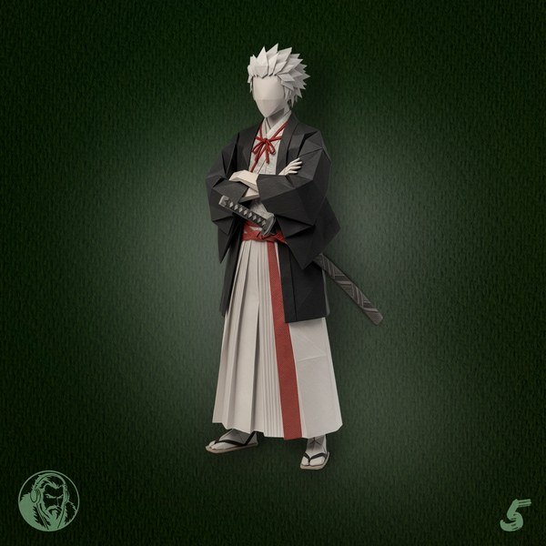 | **Welcome to the Paradise**<br><sub>144 BPM · 3:33</sub> | Hell's Paradise | `0:25` cut<br>`0:27` **drop**<br>`0:47` drop<br>`2:11` drop<br>`3:02` final drop | [YouTube](https://youtu.be/bM4FAqfHn18) | [WAV](https://github.com/Akwice/darin-ncs-free-music/releases/download/welcome-to-the-paradise/Darin_NCS_-_Welcome_to_the_Paradise.wav) |
| 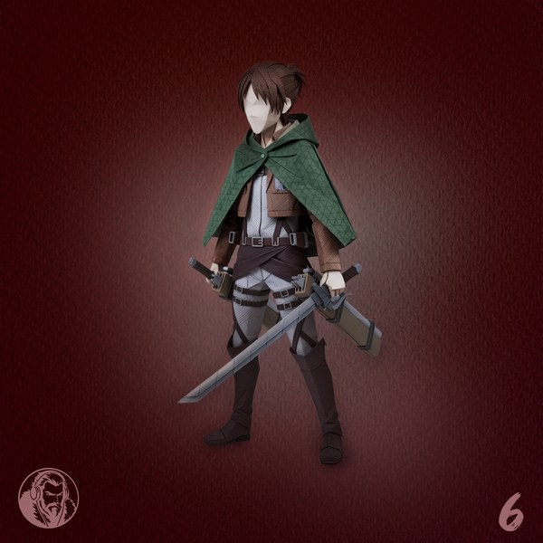 | **To Be At Peace**<br><sub>96 BPM · 3:04</sub> | Attack on Titan | `0:13` cut<br>`0:15` **drop**<br>`0:56` drop<br>`1:51` drop<br>`2:12` drop | [YouTube](https://youtu.be/NmrLukq3AxI) | [WAV](https://github.com/Akwice/darin-ncs-free-music/releases/download/to-be-at-peace/Darin_NCS_-_To_Be_At_Peace.wav) |
| 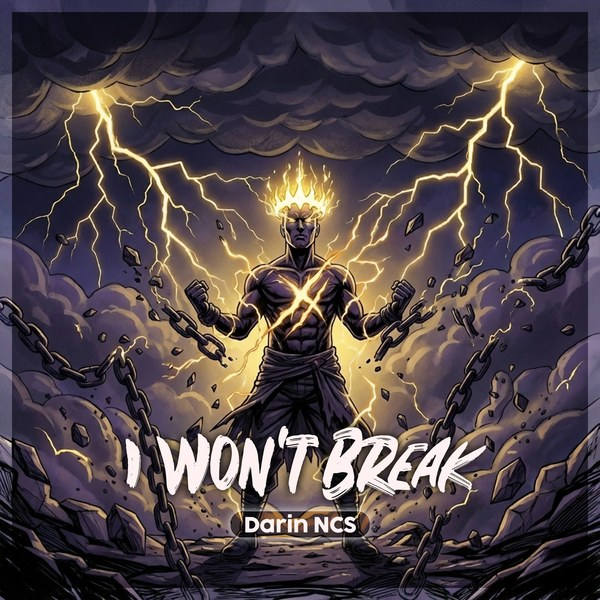 | **I Won't Break**<br><sub>103 BPM · 3:23</sub> | Any anime, comeback arcs | `0:08` **drop**<br>`0:57` drop<br>`2:05` drop<br>`2:45` cut<br>`2:53` final drop | [YouTube](https://youtu.be/_42i9lsIf5U) | [WAV](https://github.com/Akwice/darin-ncs-free-music/releases/download/i-wont-break/Darin_NCS_-_I_Wont_Break.wav) |
| 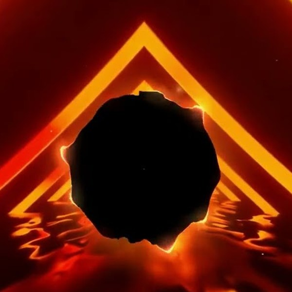 | **Back in the Shadows**<br><sub>136 BPM · 2:45</sub> | Any anime | `0:14` **drop**<br>`1:04` cut<br>`1:07` drop<br>`2:19` cut<br>`2:21` final drop | [YouTube](https://youtu.be/eXkwnslRHAI) | [WAV](https://github.com/Akwice/darin-ncs-free-music/releases/download/back-in-the-shadows/Darin_NCS_-_Back_in_the_Shadows.wav) |
| 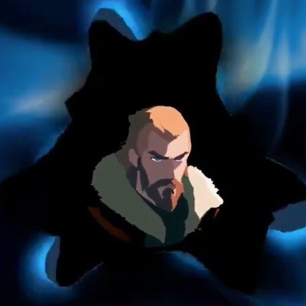 | **Echoes of the Past**<br><sub>99 BPM · 3:27</sub> | Any anime | `0:27` **drop**<br>`1:06` drop<br>`2:24` drop<br>`3:13` drop | [YouTube](https://youtu.be/WNJJ8g3UYbg) | [WAV](https://github.com/Akwice/darin-ncs-free-music/releases/download/echoes-of-the-past/Darin_NCS_-_Echoes_of_the_Past.wav) |

<sub>New tracks every week. All WAV files are full-quality stereo masters (16 or 24-bit), mastered at about −12 LUFS. Edit points on older tracks are detected automatically: give them a listen before you cut.</sub>

## Tracks on request

Need a track for your next edit? Send me three things and I'll make it, **for free**:

| | |
|---|---|
| **Theme** | revenge, awakening, heartbreak, villain arc, last stand... |
| **Anime or character** | the show, arc or character you're editing |
| **Music style** | dark-pop, phonk, rock, cinematic, slowed, EDM drop... |

Email **darin.gmv@gmail.com** with "Request" in the subject. Requested tracks come out on the channel and in this repo, copyright-free like the others.

## How to use them

1. Tap the track's **WAV** link: the download starts right away (all files are also in [`tracks/`](tracks) and the [Releases](https://github.com/Akwice/darin-ncs-free-music/releases)).
2. Use it in your edit: YouTube, YouTube Shorts, TikTok, Instagram Reels, Twitch, and more.
3. Add the credit in your description:

```
Music: Darin NCS - Track Name
https://youtu.be/<link of the track>
```

### You can
- Use the tracks in edits, AMVs, Shorts, streams and videos, monetized or not.
- Cut, loop, slow down or speed up the audio to fit your edit.

### Please don't
- Re-upload a track on its own as a music-only video or to streaming platforms.
- Claim the music as your own or register it with Content ID.
- Sell the tracks or include them in sound packs.

Content ID is turned off on every Darin NCS track, so your edits won't get claims. If something ever goes wrong, write to me and I'll sort it out.

## Made an edit with a track?

Send me the link: I share the best edits on the channel. Email **darin.gmv@gmail.com** or comment under the track on YouTube.

Want to know when a new track drops? Join the **[Discord](https://discord.gg/fcUTQS8tfF)**: every new track is posted there first. Prefer email? Write "subscribe" to the same address. Already on the list and want out? Reply **STOP** to any email and you won't hear from me again.

---

<p align="center"><sub>Darin NCS · music made with AI tools (Suno), mixed and mastered for editing · <a href="https://www.youtube.com/channel/UCigaJiPLjDdbjokZFFs4-QA">YouTube</a></sub></p>
